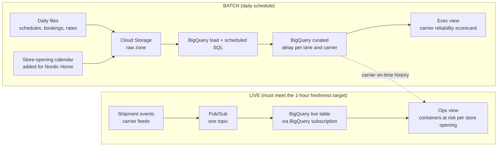

# Architecture: SHP02 Nordic Home

Targets: freshness **1 hour** · reliability **75% on time on every lane** · budget **$45 per month**.
Ocean only, 4 lanes. Adapted from the reference platform in `architecture/`.

## Changes from the reference platform

| Change | Why, for Nordic Home |
|---|---|
| **Removed Kafka** | One message broker is enough for 4 ocean lanes; a second costs money and adds operations. |
| **Removed Dataflow** in the live path | A Pub/Sub BigQuery subscription writes events straight into BigQuery within seconds, which is far inside 1 hour, with no always-on workers. |
| **Removed Dataproc** | About 2 MB of files a month; scheduled SQL in BigQuery does the processing for a fraction of a Spark cluster's cost. |
| **Added a store-opening calendar** | A late container only matters against a showroom's opening date; joining the two shows which openings are at risk. |
| **Added a carrier reliability scorecard** | Three of four lanes miss 75% (see `docs/metrics.md`); Nordic Home needs on-time rates per carrier and lane to choose carriers. |

## Live or batch

- **Live:** shipment events, Pub/Sub, BigQuery live table, ops view. Containers can be delayed at any point, and the ops team must react within the hour.
- **Batch:** schedules, bookings, rates, store calendar, curated tables, exec view. Carriers send these once a day and reliability is judged over weeks, so a daily run is enough.
